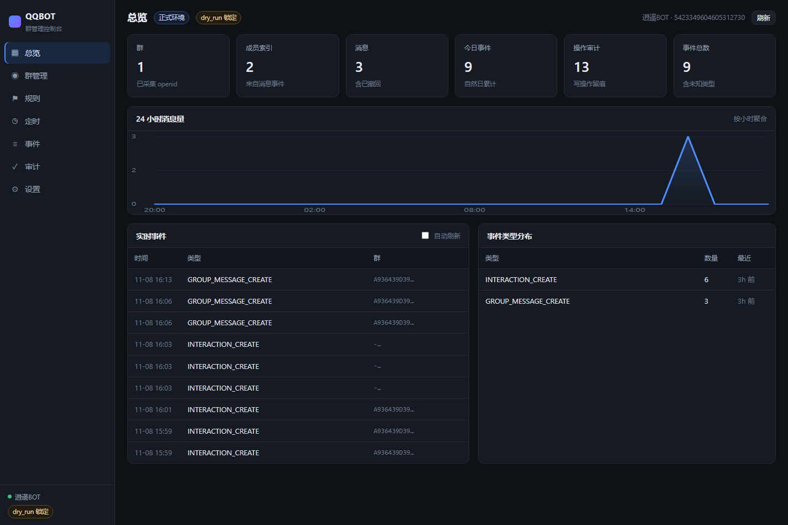
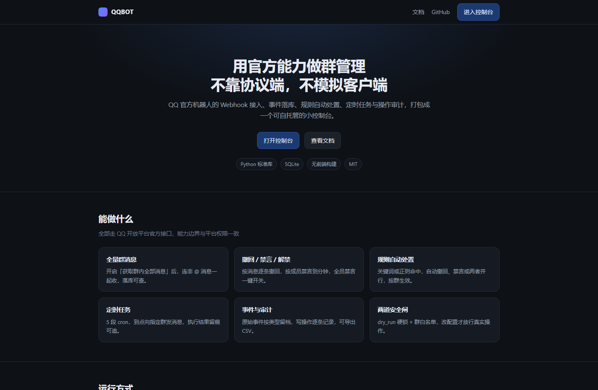
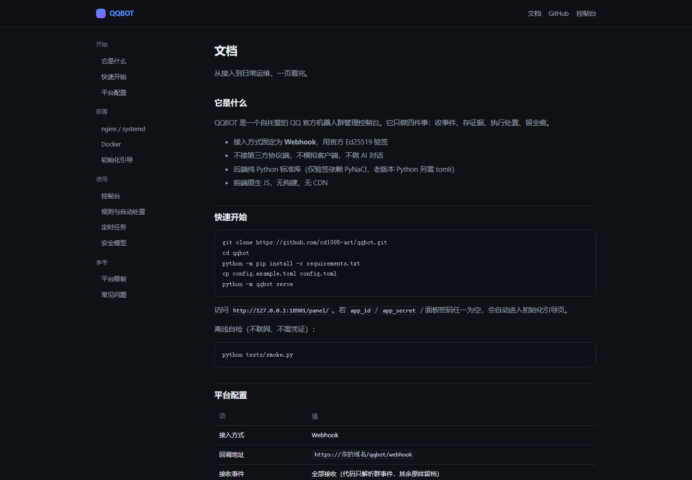

# QQBOT — QQ 官方机器人群管理控制台

用 QQ 开放平台的官方能力，把群管理做成一个可自托管的控制台：**收事件、存证据、执行处置、留全痕**。
不接第三方协议端，不模拟客户端，不做 AI 对话。

```
QQ 平台 --HTTPS POST--> https://你的域名/qqbot/webhook
                              │  nginx（443，TLS）
                              ▼
                     127.0.0.1:18900  webhook 接收端（验签 + 异步落库）
                     127.0.0.1:18901  面板 API
                              │
                              ▼
                     SQLite（群 / 成员 / 消息 / 审计 / 原始事件）
```

面板静态资源由 nginx 直接读站点目录，只有 `/panel/api/` 反代到 Python。

## 界面



<p align="center">
  
  
</p>

## 能力

| 能力 | 状态 |
|---|---|
| 全量群消息接收（含非 @ 消息） | 可用 |
| 撤回消息（2 分钟窗口） | 可用 |
| 成员禁言 / 解禁 / 全员禁言 | 可用 |
| 发送消息 / @全体成员（官方标签 + 每日配额） | 可用 |
| 入群申请列表 / 审批 | 可用 |
| 群信息 / 机器人群内状态 | 可用 |
| Web 控制台（总览 / 群管理 / 规则 / 定时 / 事件 / 审计 / 设置） | 可用 |
| 关键词自动处置（撤回 / 禁言 / 撤回+禁言） | 可用 |
| 定时任务（cron，多群，执行历史） | 可用 |
| 群级自动处置开关 | 可用 |
| 移出成员 / 群黑名单 / 成员列表接口 | **平台未开放（11253）** |

## 快速开始

```bash
git clone https://github.com/<you>/qqbot.git
cd qqbot
python -m pip install -r requirements.txt
cp config.example.toml config.toml   # 填 app_id / app_secret / panel.password
python tests/smoke.py                # 离线自检
python -m qqbot check                # 本地模拟平台校验与事件推送
python -m qqbot serve                # 同时启动 webhook(18900) 与面板(18901)
```

打开 `http://127.0.0.1:18901/panel/`。若 `app_id` / `app_secret` / 面板密码任一为空，会直接进入**初始化引导**，填完即写 `config.toml` 并热生效，不需要重启。

初始化完成后再调 `/panel/api/setup` 一律返回 403，防止远程改写凭证。

## 平台侧配置

| 项 | 值 |
|---|---|
| 接入方式 | Webhook |
| 回调地址 | `https://你的域名/qqbot/webhook` |
| 接收事件 | 全部接收（代码只解析群事件，其余原样留档） |
| 群聊消息范围 | 手机 QQ 群设置里改为「获取群内全部消息」 |
| 主动发言 | 同上，打开「允许机器人主动在群聊内发言」 |
| 群内身份 | 机器人需设为群管理员 |

保存回调地址时平台会立刻发 `op=13` 校验，服务没起来就保存失败。

## Docker

```bash
docker compose up -d
```

等价的手写方式：

```bash
docker build -t qqbot:latest .
docker run -d --name qqbot \
  -p 127.0.0.1:18900:18900 -p 127.0.0.1:18901:18901 \
  -v ./config:/app/config -v ./data:/app/data \
  qqbot:latest
```

容器内监听 `0.0.0.0`（`QQBOT_BIND`），宿主机端口仍绑 `127.0.0.1`，对外统一由 nginx 进来。首次启动会自动从 `config.example.toml` 生成配置。

## 部署

nginx 参考 `deploy/nginx-qqbot-webhook.conf`：

- `/qqbot/webhook` → `127.0.0.1:18900`
- `/panel/api/` → `127.0.0.1:18901`
- `/panel/` → 站点目录静态文件

```bash
sudo cp deploy/qqbot.service /etc/systemd/system/
sudo systemctl daemon-reload && sudo systemctl enable --now qqbot
journalctl -u qqbot -f
```

把 `deploy/` 里的路径、域名换成你自己的。

## 命令行

写操作需同时满足 `safety.dry_run = false` 且加 `--apply`。

```bash
python -m qqbot groups                          # 已知群
python -m qqbot members --group <g>             # 成员索引
python -m qqbot types                           # 事件类型统计
python -m qqbot events --limit 10               # 原始事件
python -m qqbot reindex                         # 重放原始事件回填索引
python -m qqbot audit                           # 操作审计

python -m qqbot recall  --group <g> --msg <id> | --last
python -m qqbot mute    --group <g> --member <m> --minutes 60
python -m qqbot unmute  --group <g> --member <m>
python -m qqbot mute-all --group <g> --on | --off
python -m qqbot joins   --group <g>
python -m qqbot approve --group <g> --member <m> --action approve|decline
python -m qqbot send    --group <g> --text "内容"
python -m qqbot at-all  --group <g> --text "内容"
```

## 控制台

| 页面 | 内容 |
|---|---|
| 总览 | 状态条、6 张统计卡、24 小时消息趋势、实时事件流（可自动刷新）、事件类型分布 |
| 群管理 | 群切换；概览（群信息 / 趋势 / 快捷操作）、成员（禁言解禁）、消息（剩余撤回时间 + 逐条撤回）、处置记录 |
| 规则 | 新建/启停/删除，包含或正则匹配，撤回/禁言/两者，按群生效，命中测试 |
| 定时 | 5 段 cron，多群目标，下次执行预览，上次结果 |
| 事件 | 类型筛选、条数控制、原始 JSON 抽屉 |
| 审计 | 全量留痕，前端导出 CSV |
| 设置 | 凭证掩码、dry_run 开关、白名单、改面板密码、运行信息 |

## 自动处置（规则）

命中即处置，规则表 5 秒缓存，改规则不用重启。处置在独立线程执行，不阻塞 Webhook 的 3 秒响应。

```
match_type = contains | regex
action     = recall | mute | recall_mute
params     = {"minutes": 10}
groups     = []                  # 空 = 全部群
```

- 同一 `(rule_id, message_id)` 只处置一次，平台重推不会重复禁言
- `dry_run = true` 时只记一条「未执行」的处置记录，不调接口
- 群详情页可单独关闭本群的自动处置
- 每次命中写 `disposals` 表，群管理 → 处置 可查

## 定时任务

标准 5 段 cron：`分 时 日 月 周`

```
0 9 * * *       每天 09:00
*/30 * * * *    每 30 分钟
0 9 * * 1-5     工作日 09:00
```

调度线程每 20 秒扫一次到期任务；`dry_run = true` 时不发送，`last_result` 记为「dry_run 锁定，未发送」。执行结果同时写入审计。

## 验签实现

```
seed = AppSecret 反复翻倍补到 32 字节
回调校验: hex(Ed25519.sign(event_ts + plain_token))
事件验签: verify(sig, timestamp + raw_body)
```

已用官方测试向量校验（`tests/smoke.py` 内含断言）。

## 平台限制（实测）

| 限制 | 数值 |
|---|---|
| 撤回窗口 | 发出后 2 分钟 |
| 被动回复 | 5 分钟内、每条消息最多 5 次 |
| 主动消息 | Bot 60 qpm，单群 20 qpm、每天 1000 条 |
| @全体成员 | 每群每天 1 次（自然日），超限 `40034142` |
| 禁言 | 上限 30 天，仅普通成员 |
| 成员管理接口 | 需平台内邀，返回 `11253` |

## 目录

```
qqbot/          后端：配置 / 鉴权 / API / 验签 / 落库 / 事件 / webhook / 面板 / 规则 / 定时 / CLI
web/panel/      控制台：index.html + app.css + app.js + setup.html（原生，无构建）
web/landing.html 项目落地页
web/docs.html    文档页
docker/         entrypoint.sh
docs/shots/     README 用截图
deploy/         systemd 单元、nginx 片段
Dockerfile / docker-compose.yml
tests/smoke.py  离线测试：官方向量、落库、去重、cron、规则、调度
tools/deploy.py 一键部署（可选，含 SSH 上传）
PLAN.md         版本路线（P0 / P1 / P2）
```

## 许可

MIT
